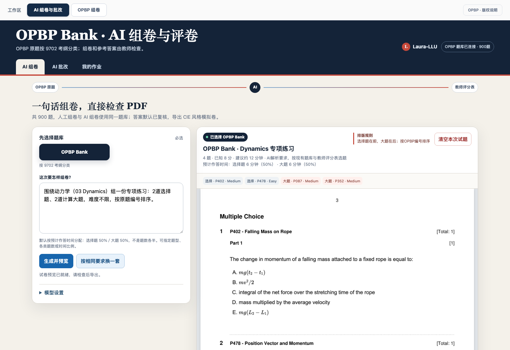
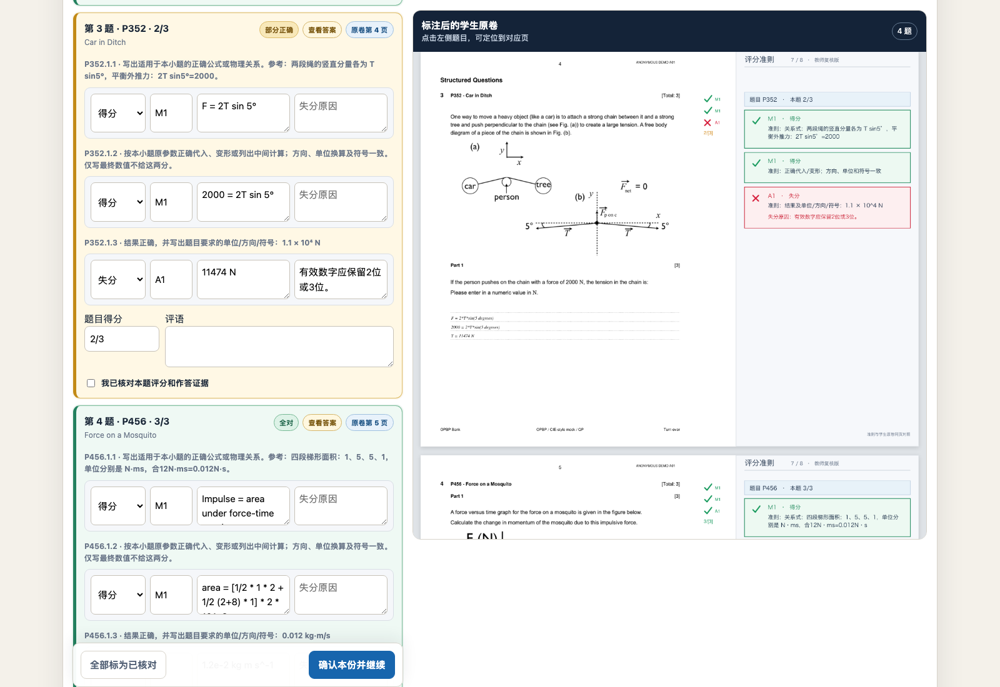
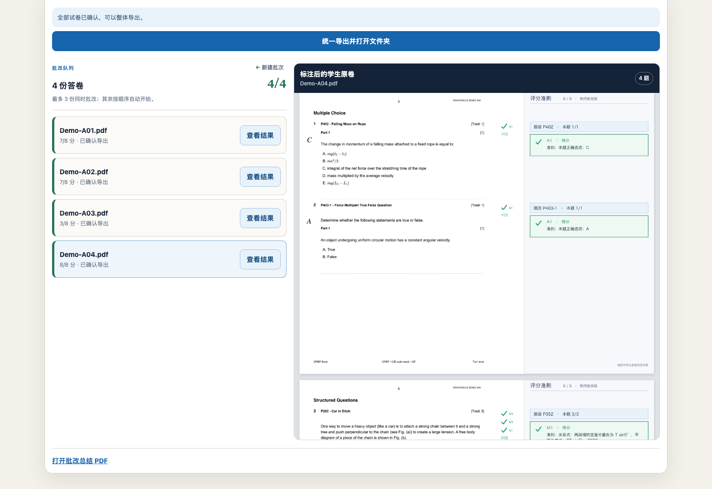

# OPBP Bank · AI 物理组卷与评卷工作台

[](https://github.com/Laura-LLU/OPBP-Bank/actions/workflows/ci.yml)
[](LICENSE)

**v0.7.44** · 本地运行、教师复核、独立部署。面向物理教师，从 OPBP 原题组卷，上传作答，检查 AI 逐点评分证据，修改确认后导出原卷批注 PDF。

上海开源软件应用创新大赛参赛项目的公开源码。900 道可选题，人工与 AI 使用同一题池；不是 Cambridge 官方产品、官方真题或官方 Mark Scheme。

当前代码以 `main` 和 [v0.7.44 Release](https://github.com/Laura-LLU/OPBP-Bank/releases/tag/v0.7.44) 为准；题图仍从安装器锁定的 v0.7.41 资源包下载，资源版本与程序版本分开。

项目统一名称为 **OPBP Bank**；macOS 应用为 `OPBP Bank.app`，GitHub 仓库为 `Laura-LLU/OPBP-Bank`。既有本地数据目录、环境变量与钥匙串标识保留兼容，改名无需重配模型或迁移历史。

## 先看：这个项目能做什么？

把教师的“选题 → 出卷 → 批改 → 复核 → 导出”放在同一工作台中。AI 提供组卷和评分建议，**最后的分数由教师检查、修改并确认**；不是无人审核的自动判分工具。

| 功能入口 | 教师怎样操作 | 得到什么 |
|---|---|---|
| AI 组卷 | 输入 Topic、题型、数量、难度或时间要求 | 从现有题库选题，预览学生卷，导出学生卷与教师答案卷 |
| OPBP 组卷 | 按题号/关键词筛选，加入选题篮，调整顺序或保留指定题目 | 可人工检查和调整的题单与整卷 PDF |
| AI 批改 | 多选或拖入答卷，先匹配题号，再确认发送 | 每份独立任务，最多3份并发，其余排队；支持暂停、继续 |
| 逐题复核 | 对照右侧原卷，查看答案，修改得分点并勾选确认 | 可追溯到原题和作答证据的教师确认结果 |
| 批量导出 | 逐份确认完成后统一导出 | 原卷批改版 PDF、批量 ZIP，以及班级批改总结 PDF |
| 我的作业 | 查看已导出的作业，打开学生卷、答案卷或定位文件 | 找回并继续使用已有试卷，不必重新组卷 |

### 一句话组卷，直接检查试卷

左侧写要求，右侧查看实际选中的题号、题型、分值和 PDF。可以按相同要求换一套，也可以进入人工组卷页面继续调整。



### 按得分点复核，与原卷同屏对照

全对、部分正确、全错分别用绿、黄、红区分。示例中 P352 的过程分保留，最终结果因有效数字不符扣分；教师仍可逐点核对再确认。



### 逐份确认后，一次导出整个批次

确认一份后自动进入下一份，全部完成再统一导出。班级总结以 PDF 链接提供，按题序统计全对率、平均得分率与常见问题，标出建议评讲题。



**[查看完整功能与操作图解：选题、上传、三并发、复核、导出与总结](docs/FEATURE_TOUR.md)**。点击图片可放大。

截图来自 v0.7.44 的真实网页和导出文件，使用专为展示制作的匿名排版答卷；AI 规划与评分响应由本机模拟服务提供，**不代表真实模型的手写识别准确率**。截图素材的来源、修改和许可见[截图署名](docs/images/ATTRIBUTION.md)。

## 新 Mac 快速部署

需要 Git、网络和 Python 3.10–3.14，**推荐 Python 3.12**。独立环境不修改系统 Python。

```bash
git clone https://github.com/Laura-LLU/OPBP-Bank.git
cd OPBP-Bank
export SSL_CERT_FILE="${SSL_CERT_FILE:-/etc/ssl/cert.pem}"
python3 scripts/setup_environment.py --venv .venv
.venv/bin/python scripts/run_web.py --check
.venv/bin/python scripts/run_web.py --open
```

打开 http://127.0.0.1:8895/ ，终端保持运行，退出用 `Control+C`。首次安装自动下载约 636 MB 的题图 Release 资源并校验 ZIP/逐文件 SHA-256。仓库不包含作者的 Python 环境、密钥、学生答卷和历史导出。

**[详细 Mac 部署指南](docs/MAC_DEPLOYMENT.md)** · [测试说明](docs/TESTING.md) · [验收记录](docs/VALIDATION.md) · [已知限制](docs/KNOWN_LIMITATIONS.md)

## 一键自动化测试

无需 API Key，不调用付费模型，使用独立状态与输出目录：

```bash
.venv/bin/python scripts/run_tests.py --install --output test-results
```

输出 JSON、JUnit、日志、浏览器截图、PDF/ZIP 与覆盖率页面。覆盖规则、接口、浏览器、三并发/暂停续作/教师确认、同页标注、批量统计导出和模拟模型 HTTP 全流程。**Mock 成功不等于真实模型识别准确率。**

## 核心流程

1. 人工选题，或以自然语言提出主题、题型、难度、数量和时间要求。
2. AI 解释约束，本地程序从真实题号选题，校验数量、重复、评分点与答案。
3. 预览并导出英文主题命名的学生卷、教师答案卷，保留来源许可。
4. 最多上传 12 份答卷，每份 20 MB；先本机匹配印刷题号，教师确认后才发送作答图像至视觉模型。
5. 最多 3 份并发；当前题原子保存后暂停，继续时跳过已完成题。切页保留会话；正常关闭 App 清空界面会话，已导出文件不删除。
6. 教师逐题复核，确认本份后进入下一份，全部确认后统一下载 ZIP。
7. 同一 PDF 保留原卷、题旁勾叉、同页评分准则。班级总结按题序导出 PDF 链接。

选择题必须有可定位的明确字母/圈选/勾选证据才计分；模型结构故障单独复核，不伪装成空白。参考计算答案展示 2 位有效数字；学生等价的 2 或 3 位可接受，不强制科学计数法，单位以原题要求为准。

## 模型与隐私

无模型可先人工组卷、预览、导出。AI 需要接收者自己的账户和额度；百炼默认组卷 `qwen3.8-flash`、视觉批改 `qwen3.7-plus`，可用性与额度以服务商账户为准。

首次部署自动填入阿里云百炼北京区接口和以上两个模型，只需在“模型设置”填写自己的 API Key 并保存。不再提供 DeepSeek / 本地 Qwen 快捷入口，也不需要安装 Ollama。未填写 Key 时不会自动调用模型；旧的显式保存配置不被覆盖，自定义兼容接口仍可用于部署测试。

Mac 密钥存系统钥匙串，不写仓库或返回浏览器。Linux/Windows 使用 `LAURAPHYSICS_OPEN_API_KEY` 环境变量。仅监听 `127.0.0.1`，不是公网多用户服务。作答发送模型前应取得授权；公开样例使用匿名、自写或已许可材料。

## 工程结构

```text
server.py / core_server.py     本地 HTTP、设置、题库、文件访问
ai_workflows.py                约束组卷、批改任务、校验、标注与统计
exam_pdf.py / question_pool.py PDF 排版与统一题池
static/                       网页；题图由 Release 安装器取得
data/                         题库、逐题来源许可、资源校验清单
scripts/                      安装、启动、校验、测试、便携打包
tests/                        独立可重复自动化
.github/workflows/ci.yml       干净平台持续验收
```

## 许可证与参赛边界

**程序代码：AGPL-3.0-only**，见 [LICENSE](LICENSE)。版权保留，允许依许可使用、修改、分发和商业使用，不加“仅限比赛/禁止商用”的代码限制。

**题库不是 AGPL。** 900 道当前可选题中，709 道 CC BY-NC-SA 4.0，191 道 CC BY 4.0；113 条旧记录仅作兼容。逐题署名、原链接、许可与处理说明保留。含非商业限制的素材不会因代码允许商用而变为可商用。[内容许可](CONTENT_LICENSES.md) · [依赖说明](THIRD_PARTY_NOTICES.md)

仓库提供代码、锁定依赖、测试和指南，便于异机复现；不表示组委会已审核通过或获奖。[参赛检查表](docs/COMPETITION_CHECKLIST.md)

扫描 PNG/JPG 的自动题号识别仍有已知限制。自动化、连接测试、教师批准字段不替代真实手写准确率、全库独立正确性复核或第二台实体 Mac 验收。

[贡献指南](CONTRIBUTING.md) · [安全说明](SECURITY.md)
