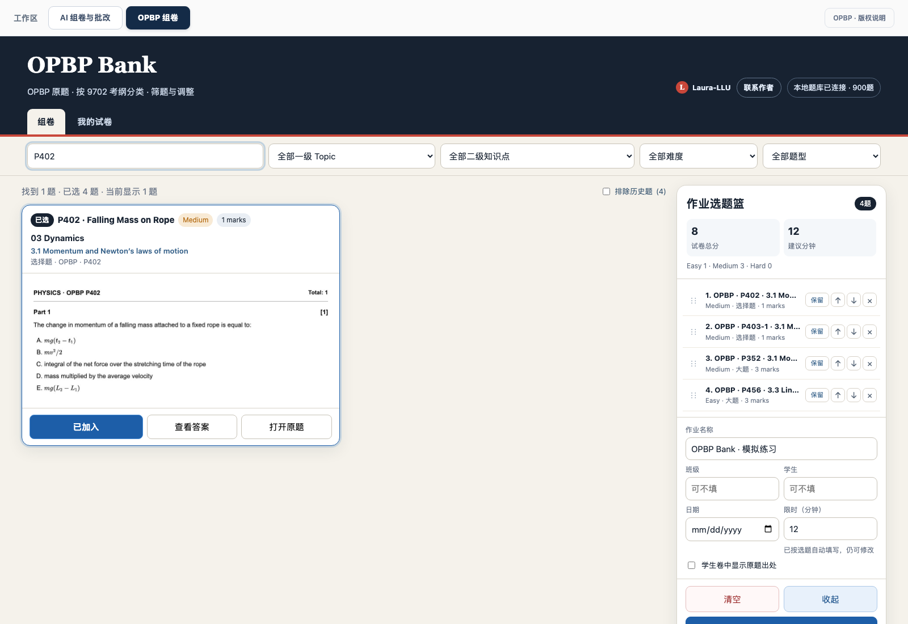
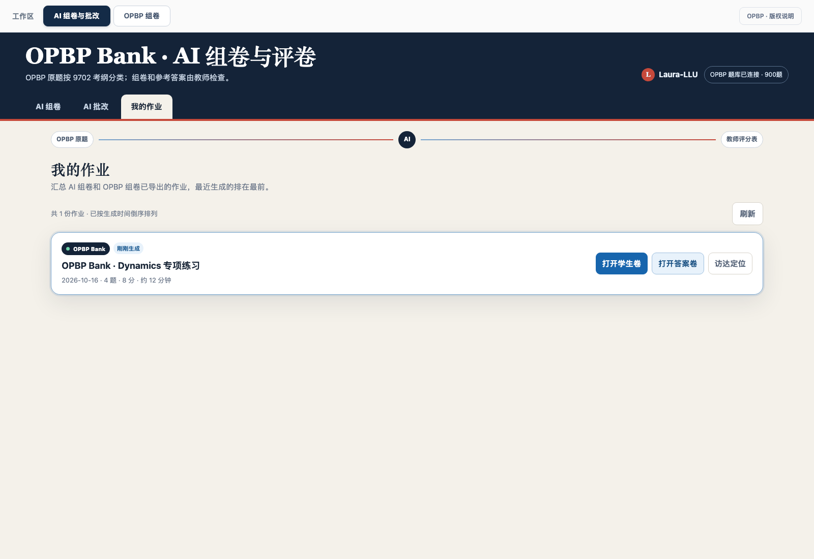
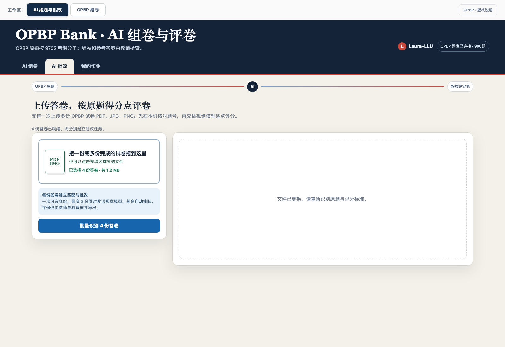
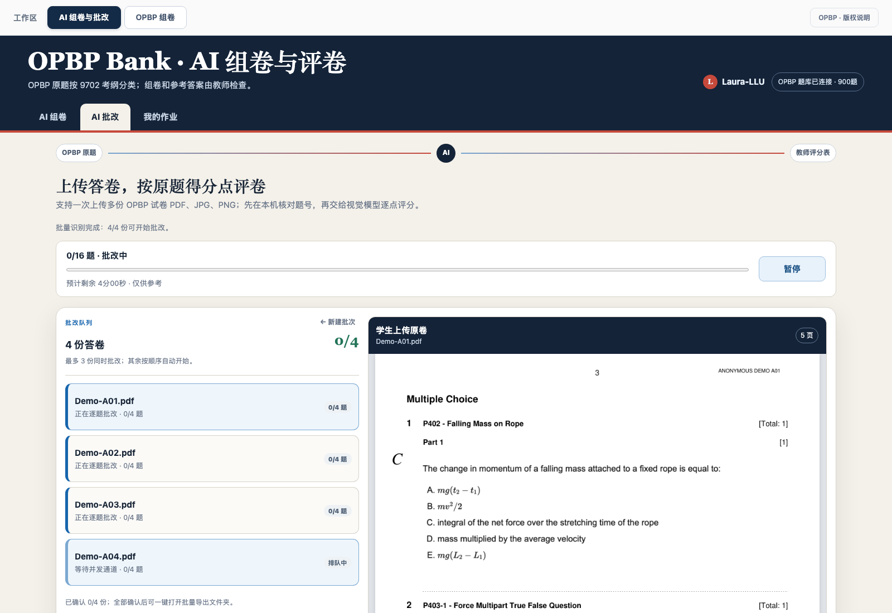
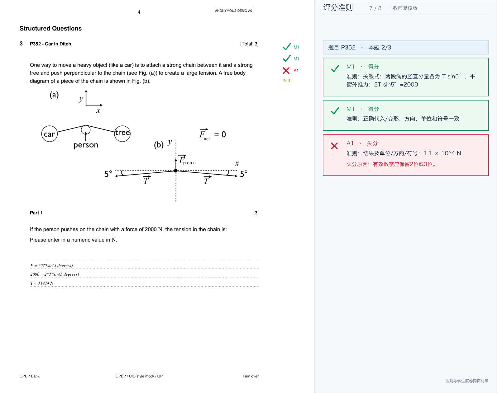
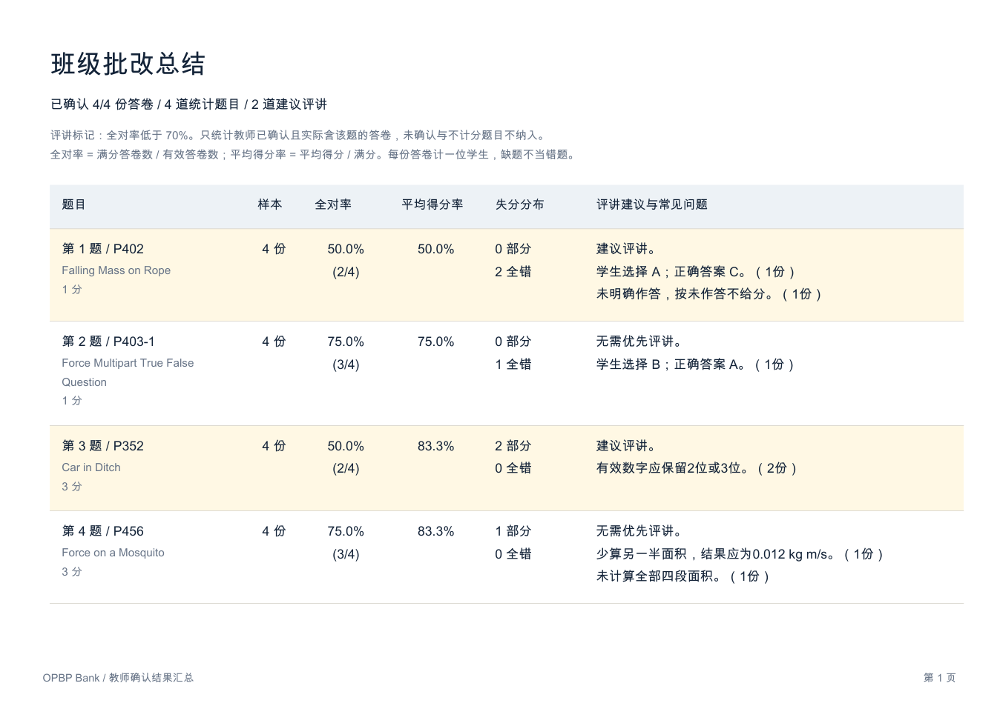

# OPBP Bank：功能与操作图解

[返回项目首页](../README.md) · [Mac 安装与更新](MAC_DEPLOYMENT.md) · [测试范围](TESTING.md) · [已知限制](KNOWN_LIMITATIONS.md)

面向需要组卷、检查学生作答和准备评讲的物理教师。核心原则是：**从现有原题选题，按对应评分点提出建议，由教师最终确认**。

> 截图版本：v0.7.44，2026-10-16。以下均为实际界面或实际导出文件，不是设计稿。答卷是专门制作的匿名排版演示，不含真实学生身份或笔迹；AI 规划/评分使用本机确定性模拟响应，不消耗真实模型额度，也不构成真实手写识别准确率证明。组卷界面与批改样例分别演示功能，不宣称每张图来自同一份试卷。点击图片可放大。

## 1. AI 组卷：先说要求，再检查结果

在“AI 组卷”选择 OPBP Bank，输入 Topic、题型、数量、难度或时间要求，点击“生成并预览”。系统从题库选原题，不凭空补题或改写题干。

示例指令：

```text
围绕动力学（03 Dynamics）组一份专项练习：2道选择题、2道计算大题，难度不限，按原题编号排序。
```

右侧可检查实际题号、题型、分值、预计作答时间与试卷。点击“按相同要求换一套”重新选题；需要调整时进入组卷页面；确认后导出学生卷和教师答案卷。


“预计作答时间”不是学生实际耗时。未指定题型数量时，混合卷默认按预计作答时间分配两类题，而不是简单各出一半题数。

## 2. 人工组卷：检索原题，自己调整题单

进入顶部“OPBP 组卷”，按题号、关键词、Topic、二级知识点、难度或题型筛选。点击“加入作业”放入右侧选题篮，可查看答案、打开原题、调整题序，或保留指定题目。

右侧显示总分、建议时长和题型/难度构成。先预览整份试卷，再导出 PDF。



人工选题、预览、导出不需要模型 Key；“900题”是当前统一可选题池数量，不是 Cambridge 官方题库认证。

## 3. 我的作业：找回已经导出的试卷

点击“我的作业”，查看最近导出的作业。每条记录可打开学生卷、答案卷或定位导出文件，避免为找文件而重新组卷。



学生卷与答案卷使用同一英文主题文件名前缀，例如 `Dynamics_Student.pdf`、`Dynamics_Answers.pdf`。班级、学生等信息由使用者按需填写，不要求输入真实身份才能体验。

## 4. 上传答卷：先本机匹配，确认后才发模型

在“AI 批改”把一份或多份已作答试卷拖到文件区域，或点击区域多选文件。支持 PDF、JPG、PNG；一次最多12份，每份不超过20 MB。

先点击识别按钮，在本机匹配 OPBP 题号与评分表；核对匹配结果后，才确认发送作答页面给配置的视觉模型。每份答卷独立保存，不混合不同答卷的内容。



演示答卷含可提取的印刷题号。支持上传图片不等于所有扫描件、倾斜照片或模糊题号均能识别；相关缺口见[已知限制](KNOWN_LIMITATIONS.md)。真实使用时，应先确认学生作答的发送授权与账户预算。

## 5. 批改队列：最多3份并发，其余自动排队

确认批量批改后，左侧显示每份进度，右侧可对照上传原卷；第四份会等待空闲通道。顶部显示总进度和估计剩余时间。



需要离开当前页面时先点“暂停”。暂停会等当前题保存后生效，不会撤销已经发送的模型请求；返回后继续已保存的进度。剩余时间仅是估计值，不是精确完成承诺。

## 6. 教师复核：看答案，也看学生原卷

点击“打开复核”，逐题查看得分点、作答证据和简短失分原因。点击“查看答案”展开参考答案，点击“原卷第N页”定位右侧对应页。教师可修改得分点和证据，勾选“我已核对本题评分和作答证据”。


- 绿：全对；黄：部分正确；红：全错。未能可靠判定的内容另行提示复核，不把接口失败当成学生空白。
- 选择题须有明确作答，不能根据排除法、草稿或正确公式替学生补选项。
- 本项目采用教师确认的数值规则：计算结果接受2或3位有效数字，不强制科学计数法；单位以原题要求为准。符号答案、精确零等情形另行处理。

截图中的 `11474 N` 仅因有效数字不符扣结果分，独立正确的过程分保留。它是固定演示案例，不是对模型普遍评分能力的结论。

## 7. 统一导出：确认本份，继续下一份

点击“确认本份并继续”后进入下一份；全部确认后返回批量结果页，再统一导出。Mac可打开导出文件夹，网页也提供 ZIP 下载链接。


本演示四份匿名答卷的总分分别为7/8、7/8、3/8、8/8；这些是人为构造的样例，不是四名真实学生的成绩。旧的已下载 PDF 不会自动变化，修改并确认后需要重新导出。

## 8. 导出效果：原卷、题旁勾叉与评分准则在同页

批改版保留学生原卷，在题旁显示勾叉和分值，右侧对齐该题评分准则与简短说明。老师不用在原卷和另一份评分报告之间来回查找。



## 9. 班级总结：按题序找出需要评讲的题

全部确认后，结果页提供批改总结 PDF 链接；批量 ZIP 也包含总结。报告按参考试卷题序排列，展示每题样本数、全对率、平均得分率、失分分布和常见问题，并标出建议评讲题。



全对率是“该题满分答卷数 ÷ 已确认且实际含该题的有效答卷数”；缺题不当错题，未确认内容不纳入统计。不要把全对率和平均得分率混为一谈。

## 评委与新部署者可以怎样体验？

1. 先按[Mac指南](MAC_DEPLOYMENT.md)安装，用人工选题 → 预览 → 学生卷/答案卷导出，验证无需模型也能完成的路径。
2. 需要实际AI组卷/批改时，在“模型设置”填入自己的服务配置和Key；首次默认阿里云百炼，额度与模型可用性取决于自己的账户。
3. 使用已授权的匿名答卷测试匹配、批改、教师复核与批量导出，再打开两个导出PDF检查对应关系和班级总结。
4. 用[自动化测试入口](TESTING.md)复跑规则、接口、浏览器与模拟模型协议。模拟成功不能替代真实模型/手写评测，也不代表组委会已审核通过。

截图中的题干、图示与评分表遵循独立内容许可，见[截图来源与修改说明](images/ATTRIBUTION.md)；代码AGPL许可不会消除素材的非商业及署名义务。
